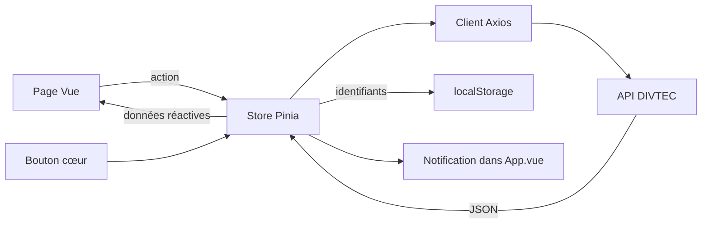

# Vogtunes — Catalogue musical Vue 3 & Vuetify

Projet individuel de Colin Vogt pour le module 294, année 2026–2027.

- [Application publiée sur Vercel](https://294-projet-deezer-vogtcol.vercel.app/)
- [Dépôt GitHub](https://github.com/colinvogt/294-projet-deezer-vogtcol)
- [Documentation de l’API pédagogique Deezer](https://apis.divtec.me/api/deezer/docs)
- [Compte rendu de la revue du code du 5 novembre 2026](docs/revue-code.md)

## 1. Présentation du projet

### Concept

Vogtunes permet de découvrir des albums, des artistes et des titres, de consulter leurs informations et de conserver ses favoris. Le projet s’adresse aux personnes qui veulent explorer un catalogue musical et retrouver leurs préférences.

L’application utilise l’API pédagogique Deezer hébergée par la DIVTEC. Ce choix permet de travailler sur la musique, avec des images et plusieurs catégories de données liées. Il s’agit d’un catalogue fourni pour l’apprentissage, et non de l’ensemble du service Deezer. Les appels utilisés sont publics et ne demandent pas de clé API.

### Fonctionnalités

- Accueil avec une sélection fixe de neuf coups de cœur, indépendante des favoris personnels.
- Catalogues d’albums, d’artistes et de titres, chargés par pages de 24 éléments.
- Recherche dans l’API, filtre par artiste ou par genre et tri alphabétique des résultats affichés.
- Fiches détaillées avec les informations disponibles dans l’API et un aperçu des éléments associés.
- Ajout et retrait de favoris dans les trois catégories, avec confirmation visuelle.
- Conservation des identifiants favoris dans le navigateur après rechargement.
- Gestion des chargements, des erreurs réseau, des résultats vides et des pages introuvables.
- Menu avec icônes seules sur petit écran et cartes adaptées à la largeur disponible.

### Aperçu

Capture de la version locale vérifiée pendant la revue du 5 novembre 2026.


[Voir la confirmation de retrait sur la page des favoris](docs/images/favoris.jpg).

## 2. Parcours d’apprentissage

Le projet s’appuie sur le tutoriel [Pokédex Vuetify de DEVJS](https://devjs.ch/exercices/pokedex-vuetify/), adapté au domaine musical. Le périmètre étudié s’arrête à la **séquence 5**, dont l’étape 17 est le récapitulatif.

| Séquence | Notions travaillées | Application dans Vogtunes |
| --- | --- | --- |
| 1 — Composants et navigation | Props, slots, pages, routes dynamiques | Cartes réutilisables, menu, listes et fiches |
| 2 — Pinia | State, getters et actions | Cache des éléments et favoris partagés |
| 3 — Axios et configuration | Requêtes HTTP, `.env`, chargement et erreurs | Client Axios commun et alertes avec nouvelle tentative |
| 4 — Recherche, filtre et tri | Champs réactifs, événements, tableaux et `computed` | Recherche et filtre dans l’API, tri local dans un `computed` |
| 5 — Favoris | Identifiants, localStorage, clic sur le cœur et feedback | Favoris persistants, page dédiée, compteur et notification |

La recherche et les filtres sont adaptés à la pagination de cette API : ils sont envoyés au serveur pour rechercher aussi les éléments qui ne sont pas encore affichés. Le tri utilise une copie du tableau chargé, sans modifier les données du store. Les états de chargement restent propres à chaque page, tandis que les appels et les objets récupérés sont centralisés dans Pinia.

Les coups de cœur, les informations des fiches et le menu compact sont des adaptations personnelles déjà présentes. Il n’y a pas de formulaire de création dans l’API, d’authentification, de suppression sur le serveur, de PWA ou d’application native.

## 3. Outils et méthodologie

### Environnement

- WebStorm pour le développement.
- JavaScript avec Vue 3, Vuetify 3, Vue Router, Pinia et Axios.
- Vite pour le serveur de développement et la compilation.
- Git et GitHub pour l’historique, Vercel pour le site publié.
- Node.js 22 ou version plus récente compatible. La revue a été exécutée avec Node.js 26.12.1 et npm 11.20.0.

Les versions exactes des dépendances sont enregistrées dans `package-lock.json`. Node.js 18 n’est pas compatible avec toutes les dépendances du projet.

### Installation en local

Depuis PowerShell :

```powershell
git clone https://github.com/colinvogt/294-projet-deezer-vogtcol.git
cd 294-projet-deezer-vogtcol
npm ci
Copy-Item .env.example .env
npm run dev
```

Ouvrir l’adresse indiquée dans le terminal, normalement `http://localhost:3000`.

La copie de `.env.example` est nécessaire à la première installation. Si un `.env` existe déjà, conserver sa configuration plutôt que l’écraser. Le fichier doit contenir :

```dotenv
VITE_API_URL=https://apis.divtec.me/api/deezer
```

Redémarrer le serveur Vite après une modification de cette variable. `.env` est prévu pour rester local et figure dans `.gitignore` ; `.env.example` contient le modèle public à partager. Un fichier déjà préparé pour commit reste toutefois suivi par Git : voir la note sur les modifications préexistantes dans le rapport de revue. Les variables préfixées `VITE_` sont visibles dans le code envoyé au navigateur et ne doivent pas contenir de secret.

### Commandes utiles

| Commande | Utilité |
| --- | --- |
| `npm run dev` | Lancer le serveur local |
| `npx eslint . --no-fix` | Vérifier le code sans le modifier |
| `npm run lint` | Vérifier le code et appliquer les corrections automatiques de style |
| `npm run build` | Construire la version de production dans `dist/` |
| `npm run preview` | Consulter localement la version construite, généralement sur le port 4173 |

Si la page devient blanche, regarder les erreurs dans la console du navigateur et le terminal Vite. Vérifier en particulier les imports, les erreurs de syntaxe, la variable d’API et les données utilisées dans le template.

### API et pagination

URL de base : `https://apis.divtec.me/api/deezer`.

| Requête utilisée | Rôle |
| --- | --- |
| `GET /albums` et `GET /albums/:id` | Liste et fiche d’album |
| `GET /artists` et `GET /artists/:id` | Liste et fiche d’artiste |
| `GET /tracks` et `GET /tracks/:id` | Liste et fiche de titre |

Les listes renvoient `{ data, pagination }`. Les fiches renvoient directement un objet. Les appels sont limités à dix secondes avant de signaler un échec.

- `limit` est limité à **100 par requête**, pas à 100 éléments pour toute l’application.
- Le catalogue demande `limit=24`, puis augmente `page` lorsque l’on clique sur « Charger la suite ».
- `q` transmet la recherche à l’API. La saisie attend 300 ms avant de relancer la recherche, et la requête précédente est annulée si elle est encore en cours.
- `artist` filtre les albums et titres ; `genres` filtre les artistes. Les suggestions viennent des éléments déjà chargés, mais on peut saisir une autre valeur puis appuyer sur Entrée.
- Le bouton A → Z / Z → A trie les éléments déjà affichés. Ce n’est pas un classement global de toutes les pages du serveur.
- Les associations utilisent des noms textuels fournis par l’API. Leur affichage est limité à un aperçu de 12 résultats, avec un compteur si d’autres existent.

Exemple : `GET /albums?page=1&limit=24&artist=Tame%20Impala` recherche les albums de cet artiste dans le catalogue, même si leurs cartes n’ont pas encore été chargées.

### Architecture

```text
src/
├── components/       Cartes, recherche, catalogue, fiche, menu et bouton favori
├── pages/            Accueil, catalogues, fiches, favoris et page 404
├── layouts/          Mise en page avec v-main et router-view
├── stores/           deezerStore pour données/favoris ; app pour notifications
├── plugins/          Configuration Axios, Vuetify et enregistrement des plugins
├── router/           Configuration du routage automatique
├── utils/            Construction des URL d’images et formatage date/durée
├── assets/           Logo
├── styles/           Configuration de styles Vuetify
├── App.vue           Structure commune et notification persistante
└── main.js           Démarrage de l’application
```

Les routes sont générées à partir des fichiers de `src/pages/`. Les composants et certaines fonctions Vue sont importés automatiquement grâce aux plugins configurés dans `vite.config.mjs`.

| Route | Contenu |
| --- | --- |
| `/` | Coups de cœur |
| `/album`, `/artiste`, `/titre` | Catalogues |
| `/Album/:id` | Fiche d’album |
| `/artiste/:id`, `/titre/:id` | Fiches d’artiste et de titre |
| `/favoris` | Favoris des trois catégories |
| Autre chemin | Page 404 |

Les fichiers `artiste.[id].vue` et `titre.[id].vue` créent des routes de détail indépendantes des listes. `Album/[id].vue` conserve la route d’album existante.



`itemsById` garde en mémoire les objets déjà récupérés. Les favoris stockent seulement les identifiants, séparés en albums, artistes et titres sous la clé `deezer_favorites`. Un identifiant d’album peut être identique à celui d’un artiste sans créer de conflit. Au rechargement, les objets manquants sont récupérés individuellement.

Les boutons cœur utilisent `@click.stop.prevent` pour éviter que l’ajout d’un favori ouvre aussi la fiche. La notification est affichée dans `App.vue` : elle reste visible quand une carte disparaît de la page favoris.

### Organisation du travail

Les changements sont regroupés par objectif dans des commits `feat:`, `fix:` ou `docs:`. La vérification combine lecture du code, contrôle de style, compilation et tests de parcours. Les composants communs évitent de copier la recherche, les favoris ou les fiches dans chaque catégorie.

### Site existant sur Vercel

Le projet est déjà publié à l’adresse indiquée en début de document. Pour reconstruire cette application sur Vercel, la configuration attendue est Vite, avec `npm run build`, le dossier de sortie `dist` et la variable `VITE_API_URL` définie lors du build. Le fichier `vercel.json` renvoie les routes vers `index.html`, ce qui permet d’ouvrir directement une fiche ou de la recharger.

Le workflow GitHub Pages présent dans `.github/workflows/deploy.yml` est hérité du modèle. Il n’est pas la procédure Vercel et sa configuration n’est pas validée pour publier cette application sur GitHub Pages. Ses limites sont relevées dans le rapport de revue.

## 4. Tests et validation

Vérifications réalisées pendant la revue du 5 novembre 2026, sur une copie locale du code corrigé :

| Vérification | Résultat observé |
| --- | --- |
| ESLint sur le projet | Réussi après correction de dix erreurs de style initiales |
| Compilation de production | Réussie |
| Accueil | Neuf coups de cœur chargés |
| Pagination albums | Passage de 24 à 48 résultats sur 1 000 |
| Filtre saisi « Tame Impala » | Deux albums trouvés, même sans suggestion initiale |
| Tri inversé | Ordre des deux albums inversé |
| Recherche sans résultat | Compteur nul et message explicite |
| Filtre artistes « Rock » | Résultats filtrés, avec pagination |
| Recherche titre « Dark Red » | Un résultat et ouverture de sa fiche |
| Navigation entre fiches | Titre → Steve Lacy → Gemini Rights |
| Rechargement direct d’une fiche | Détails toujours affichés |
| Identifiant invalide et route inconnue | Message introuvable et page 404 |
| Ajout/retrait de favoris | Compteur mis à jour et confirmation visible |
| Rechargement des favoris | Favori conservé |
| Cœur activé avec Entrée | Ajout effectué sans ouvrir la fiche |
| Menu à 320 pixels | Cinq liens visibles, sans débordement horizontal sur les pages vérifiées |
| API volontairement inaccessible | Alertes et bouton Réessayer sur catalogue et fiche |
| Console des parcours normaux testés | Aucun avertissement ni erreur observé |

Douze vérifications isolées supplémentaires ont été exécutées pendant la revue avec les vrais stores Pinia et des réponses API/stockage simulées en mémoire. Elles couvrent notamment les identifiants en double, le JSON invalide, les refus de stockage, les favoris indisponibles, la persistance et les paramètres de pagination. Ce script de revue temporaire n’est pas une suite de tests livrée dans le dépôt.

Le site Vercel existant a été consulté séparément : l’accueil et le rechargement de la fiche Deadbeat fonctionnaient. Cela ne signifie pas que les corrections locales de cette revue sont déjà déployées.

### Scénario de démonstration

1. Ouvrir Albums, charger la suite, puis saisir « Tame Impala » dans le filtre et valider avec Entrée.
2. Inverser le tri, ouvrir une fiche et consulter ses informations.
3. Ajouter un favori, aller dans Favoris, puis recharger la page.
4. Retirer le favori et observer la confirmation ainsi que le message de liste vide.
5. Tester une recherche inexistante et une adresse telle que `/titre/invalide`.
6. Réduire la largeur du navigateur pour contrôler l’accès au menu.

### Limites connues

- L’application dépend de la disponibilité de l’API et des images. Le mode hors ligne n’est pas implémenté ; les consignes l’exemptent pour 2026–2027.
- Les favoris appartiennent au navigateur et à l’adresse du site. Ils ne sont pas synchronisés entre appareils ; effacer les données du navigateur les supprime.
- Si le stockage est refusé, l’action fonctionne pour la session avec un avertissement, mais elle peut être perdue au rechargement.
- Un favori indisponible est conservé jusqu’à une nouvelle tentative réussie ou son retrait explicite par l’utilisateur.
- Le cache des objets est conservé pour la session. Il ne garantit pas une actualisation immédiate des données du serveur.
- Le tri porte sur les résultats chargés ; les éléments associés sont limités à 12 et certains liens musicaux peuvent manquer dans le catalogue pédagogique.
- Les tests d’accessibilité réalisés sont des contrôles de base, pas un audit WCAG complet. Tous les appareils et tous les enregistrements de l’API n’ont pas été testés.

## 5. Usage de l’intelligence artificielle

### Outil et transparence

ChatGPT / Codex (OpenAI) a été utilisé pour comprendre le code, proposer et écrire des modifications, déboguer et rédiger la documentation. La version précise de chaque échange n’a pas été consignée.

### Travail personnel et aide reçue

J’ai écrit moi-même le code de départ, ligne par ligne, en suivant le tutoriel Pokédex Vuetify jusqu’à la séquence des favoris et en l’adaptant à mon projet musical. Lorsque je ne comprenais pas une erreur, j’ai demandé de l’aide à l’IA pour comprendre mon problème et corriger les bugs.

À partir de l’adaptation des favoris, dont le fonctionnement différait de l’exemple du tutoriel, j’ai demandé une aide plus directe à l’IA. Cette aide a ensuite compris des propositions et des modifications de code appliquées au projet, ainsi que des explications détaillées. Les interventions réalisées avec l’IA ont notamment porté sur :

- la pagination et la recherche distante en respectant la limite de 100 éléments par requête ;
- le chargement des favoris par identifiant ;
- la sélection de l’accueil, le menu compact et les fiches détaillées ;
- la revue du code et les corrections des notifications, de la persistance, du filtre et de l’accessibilité ;
- les tests de la revue et la rédaction de ce README.

La répartition personnelle/IA n’a pas été mesurée. Il n’est donc pas possible d’attribuer honnêtement un pourcentage précis à chaque fichier ou domaine. Les tests de cette revue ont été réalisés avec l’assistance de Codex.

### Compréhension et adaptation

J’ai demandé des explications détaillées sur les modifications, parfois ligne par ligne, notamment pour le store, les appels API, la limite de 100 éléments et la recherche. Le code a été adapté aux trois catégories musicales, aux champs de l’API DIVTEC et à mon choix de coups de cœur.

Le thème musical, les éléments choisis pour l’accueil, les demandes de fonctionnement et le bilan personnel viennent de moi. Le projet repose aussi sur le modèle Vuetify et le tutoriel du cours. Je dois pouvoir expliquer le code utilisé pendant la défense orale ; cette documentation ne remplace pas cette compréhension.

## 6. Bilan personnel

### Ce que j’ai appris

J’ai appris à gérer des données grâce à une API et à les afficher dans une application web.

### Difficultés rencontrées

Ma principale difficulté a été de comprendre mes erreurs. Une faute dans le code pouvait provoquer une page complètement blanche, sans que je voie immédiatement ce qui n’allait pas. J’ai dû reprendre mon code en détail pour chercher l’origine du problème. Les explications reçues m’ont aussi aidé à comprendre le fonctionnement des parties modifiées.

### Réussites et fiertés

Je suis fier du site lui-même et de ce que j’ai accompli. Le résultat est une application musicale qui fonctionne et qui est publiée en ligne.

### Améliorations possibles

Les pistes identifiées pendant la revue concernent surtout une meilleure actualisation du cache, un tri global si l’API le permet, des filtres proposant davantage de suggestions et des tests sur d’autres appareils. Elles ne sont pas présentées comme des fonctionnalités déjà réalisées.

## 7. Références et sources

- [Consignes du projet individuel évaluatif](https://tirtho.notion.site/Projet-individuel-valuatif-Application-Vue-3-Vuetify-avec-API-268e74c07f7c80e5822adb530f7a6027)
- [Tutoriel Pokédex Vuetify — séquences 1 à 5](https://devjs.ch/exercices/pokedex-vuetify/)
- [Étape 16 — Interface favoris](https://devjs.ch/exercices/pokedex-vuetify/e16.html)
- [Étape 17 — Récapitulatif de la séquence 5](https://devjs.ch/exercices/pokedex-vuetify/e17.html)
- [API pédagogique Deezer DIVTEC](https://apis.divtec.me/api/deezer/docs)
- [Vue 3](https://vuejs.org/guide/introduction.html), [Vue Router](https://router.vuejs.org/) et [Pinia](https://pinia.vuejs.org/)
- [Vuetify 3](https://vuetifyjs.com/)
- [Axios](https://axios-http.com/docs/intro)
- [Vite — Variables d’environnement](https://vite.dev/guide/env-and-mode.html)
- [Vercel — Applications Vite et routes SPA](https://vercel.com/docs/frameworks/frontend/vite#using-vite-to-make-spas)

Les pochettes et images d’artistes affichées proviennent de l’API pédagogique. L’utilisation de l’IA est décrite dans la section 5.
