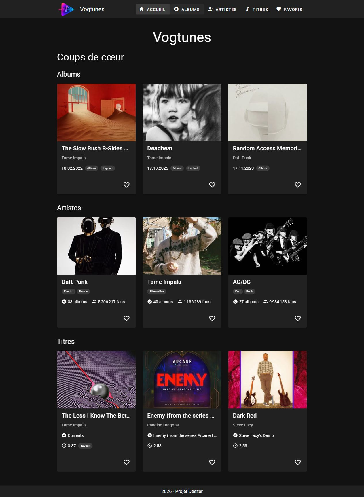
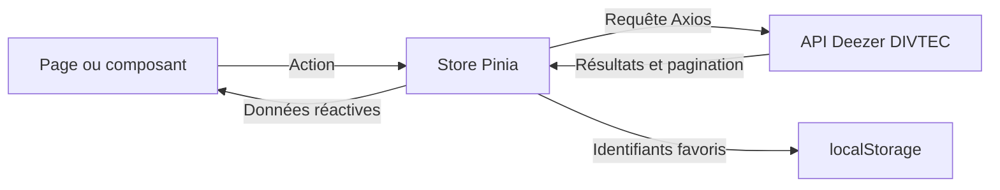

# 🌐 Vogtunes — Mon projet Vue.js & Vuetify

Projet individuel de Colin Vogt pour le module 294, année 2026–2027.

- [Application en ligne sur Vercel](https://294-projet-deezer-vogtcol.vercel.app/)
- [Code source sur la branche simplification-oral](https://github.com/colinvogt/294-projet-deezer-vogtcol/tree/simplification-oral)

## 1. 🎨 Présentation du projet

### Concept

Vogtunes s’adresse aux personnes qui veulent découvrir des albums, des artistes et des titres, puis retrouver leurs préférés. J’ai choisi l’API pédagogique Deezer de la DIVTEC parce que la musique m’intéresse et que cette API propose des données liées entre elles, avec des pochettes et des photos. Elle fournit un catalogue pédagogique accessible sans clé API.

### Fonctionnalités principales

- Découvrir neuf coups de cœur sur l’accueil et parcourir les trois catalogues par pages de 24 résultats.
- Rechercher dans le catalogue, filtrer par artiste ou par genre et trier les résultats affichés de A à Z ou de Z à A.
- Ouvrir la fiche d’un album, d’un artiste ou d’un titre et consulter un aperçu des éléments associés.
- Ajouter ou retirer un favori et voir une confirmation.
- Retrouver ses favoris dans le même navigateur après rechargement.
- Utiliser le menu avec des icônes sur petit écran.

### Aperçu visuel



[Voir la page Favoris avec la confirmation de retrait](docs/images/favoris.jpg)

---

## 2. 📚 Parcours d’apprentissage

### Ressources utilisées

#### Documentation & tutos

- [Pokédex Vuetify de DEVJS](https://devjs.ch/exercices/pokedex-vuetify/), suivi jusqu’à la séquence 5. L’étape 16 porte sur l’interface des favoris et l’étape 17 récapitule cette séquence.
- [Documentation Vue 3](https://vuejs.org/guide/introduction.html), [Vuetify 3](https://vuetifyjs.com/en/components/all/) et [Pinia](https://pinia.vuejs.org/).
- [Documentation de l’API pédagogique Deezer](https://apis.divtec.me/api/deezer/docs).

#### Progression

Les dates ci-dessous viennent de l’historique Git.

| Période | Travail réalisé |
| --- | --- |
| 22–29 septembre 2026 | Initialisation, en-tête et pied de page. |
| 16 octobre | Premiers albums chargés depuis l’API, store, cartes et fiche d’album. |
| 24 octobre | Axios, états de chargement et d’erreur, catalogues d’artistes et de titres, navigation. |
| 2–4 novembre | Recherche, filtres, tri, pagination, favoris persistants, accueil et menu mobile. |
| 5–9 novembre | Corrections des favoris, de l’accessibilité et de la validation des données, puis rédaction du README. |
| 10 novembre | Simplification des fiches, des listes et de la pagination pour la défense orale. |

---

## 3. 🛠️ Outils et méthodologie

### Environnement de développement

- WebStorm pour développer, Git et GitHub pour suivre les changements.
- JavaScript, Vue 3, Vuetify 3, Vue Router, Pinia, Axios et Vite.
- Node.js 22 ou une version plus récente compatible.
- `.env.example` contient l’adresse publique de l’API. Le fichier `.env` reste local et est ignoré par Git.

### Installation & Run

Dans PowerShell, pour travailler sur la branche de préparation à l’oral :

```powershell
git clone --branch simplification-oral https://github.com/colinvogt/294-projet-deezer-vogtcol.git
cd 294-projet-deezer-vogtcol
npm ci
Copy-Item .env.example .env
npm run dev
```

Ouvrir l’adresse indiquée par Vite, normalement `http://localhost:3000`. Si un fichier `.env` est déjà configuré, garder celui-ci. La variable `VITE_API_URL` doit pointer vers `https://apis.divtec.me/api/deezer`.

Pour contrôler le projet, lancer `npx eslint . --no-fix` puis `npm run build`. Le workflow GitHub exécute ces vérifications sur les changements vers `main`. Vercel utilise le dossier `dist` produit par la compilation, et `vercel.json` permet de recharger directement une fiche.

### Méthodologie

- Les pages réutilisent les cartes d’albums, d’artistes et de titres. Elles leur transmettent les données avec des props. Le catalogue partage sa grille entre les trois catégories grâce à un slot.
- Le clic sur le cœur appelle une action du store Pinia. Les composants lisent ensuite l’état mis à jour dans le store.
- Les commits sont regroupés par changement avec les préfixes `feat:`, `fix:` et `docs:`. Les vérifications combinent des essais manuels, ESLint, la compilation et des tests ciblés du store.

### Choix techniques

L’API pédagogique Deezer fournit les trois catégories dont le projet a besoin.

| Requêtes | Utilisation |
| --- | --- |
| `GET /albums` et `GET /albums/:id` | Liste et fiche d’album. |
| `GET /artists` et `GET /artists/:id` | Liste et fiche d’artiste. |
| `GET /tracks` et `GET /tracks/:id` | Liste et fiche de titre. |

L’API accepte jusqu’à **100 éléments par requête**. Le catalogue en demande **24** à la fois et avance seulement quand la réponse arrive avec succès. La recherche (`q`) et le filtre (`artist` ou `genres`) sont envoyés à l’API pour couvrir aussi les pages encore invisibles. Le tri réordonne les cartes déjà chargées. Les fiches affichent jusqu’à 12 éléments associés.

### Architecture

| Fichier ou dossier | Rôle |
| --- | --- |
| `src/App.vue`, `src/layouts/` | Structure commune, navigation et affichage des notifications. |
| `src/pages/` | Accueil, catalogues, fiches, favoris et page 404. |
| `src/components/` | Cartes, catalogue partagé, fiche et bouton favori. |
| `src/stores/` | Requêtes, cache, favoris et état des notifications. |
| `src/plugins/axios.js` | Client HTTP et adresse de l’API. |



Quand on clique sur « Charger la suite », le composant calcule le numéro de page et appelle `fetchCataloguePage`. Le store envoie la requête, vérifie la réponse et renvoie les résultats au composant qui les ajoute à la liste. Quand on clique sur un cœur, le store ajoute ou retire l’identifiant, puis sauvegarde les favoris dans `localStorage`. Au rechargement, il récupère les informations des favoris à partir de leurs identifiants.

---

## 4. 🧪 Tests et validation

### Tests techniques

- ESLint et la compilation de production réussissent sur la version locale vérifiée le 10 novembre 2026. Les 15 tests ciblés du store passent avec des réponses et un stockage simulés. Le script utilisé pour la revue est conservé hors du dépôt.
- Les essais dans le navigateur ont couvert le chargement des catalogues et la navigation du titre « Dark Red » vers l’artiste Steve Lacy, puis vers l’album « Gemini Rights ».
- Après ajout d’un favori et rechargement de la page, le favori réapparaît. Son retrait met à jour la liste et affiche une confirmation.

### Tests d’UX

- « Charger la suite » fait passer la liste d’albums de 24 à 48 résultats. Le filtre « Tame Impala » et l’inversion du tri ont été testés.
- Le chargement, les erreurs et les listes vides ont chacun un message ou un indicateur dédié.
- Les cinq entrées du menu restent accessibles à 320 pixels sur les vues vérifiées.

### Tests d’accessibilité

- Les boutons du menu et les cœurs ont des libellés, et les images des cartes ont un texte alternatif.
- Le cœur a été activé au clavier avec Entrée sans ouvrir la fiche. Le lien du logo dispose d’un style de focus visible.
- Le contraste n’a pas été mesuré systématiquement. Le cœur est imbriqué dans le lien de la carte, un point à améliorer pour certains lecteurs d’écran.

### Tests d’erreurs & fallback

- En simulant une API inaccessible, le catalogue et la fiche affichent une alerte et un bouton « Réessayer ». Le mode hors ligne avec données simulées est facultatif pour 2026–2027. [Consignes du professeur](https://tirtho.notion.site/Projet-individuel-valuatif-Application-Vue-3-Vuetify-avec-API-268e74c07f7c80e5822adb530f7a6027)
- Si une page échoue, « Réessayer » redemande cette page. Une nouvelle recherche repart à la page 1.
- Une recherche sans résultat, une liste de favoris vide et une adresse de fiche invalide affichent chacune un message adapté.

---

## 5. 🤖 Usage d’intelligence artificielle

### IA utilisée

J’ai utilisé ChatGPT / Codex (OpenAI) pour comprendre des erreurs, obtenir des explications, apporter des corrections, simplifier du code et rédiger la documentation. Les versions précises utilisées à chaque échange n’ont pas été consignées.

### Utilisation détaillée

**Domaines d’aide** (estimations par domaine) :

- Aide au code général : ~40 %
- Génération de snippets Vue/Vuetify : non estimée
- Aide à la structuration du projet : ~20 %
- Débogage : ~100 %
- Recherche d’idées : 0 %

J’estime l’utilisation de l’IA à **40–50 % sur l’ensemble du projet**. Il s’agit d’une estimation personnelle qui comprend l’aide au code, aux corrections, aux tests et à la documentation.

L’aide a porté sur la pagination et la recherche côté API, les favoris, les fiches détaillées et le menu mobile. Codex a proposé et appliqué des changements de code, participé aux tests et aidé à structurer le README.

**Compréhension et adaptation**

Pour adapter le Pokédex à Vogtunes, les favoris ont été répartis entre albums, artistes et titres. La recherche a été envoyée au serveur pour trouver aussi des résultats en dehors de la page chargée. J’ai demandé des explications sur ces changements et sur la limite de résultats par requête.

### Parties codées manuellement

J’ai écrit le code de départ en suivant le tutoriel jusqu’à la séquence des favoris, en l’adaptant à mon projet musical. J’ai choisi le thème, les coups de cœur et les comportements que je voulais pour le site. À partir de l’adaptation des favoris, j’ai demandé une aide plus directe pour écrire et corriger certaines parties. Une partie des tests a également été faite avec Codex. Je n’ai pas mesuré de pourcentages de contribution par partie.

### Apprentissage personnel

Les explications, parfois ligne par ligne, m’ont aidé à comprendre le rôle du store, le fonctionnement des appels API et la pagination. J’ai aussi travaillé à expliquer, avec mes mots, ce qui se passe entre le clic de l’utilisateur et la mise à jour de la page.

---

## 6. 🎯 Bilan personnel

### Ce que j’ai appris

J’ai appris à récupérer les données d’une API, à les organiser et à les afficher dans une application Vue. J’ai aussi compris comment garder des favoris dans le navigateur après avoir rechargé une page, ainsi que la syntaxe et la logique de Vue.

### Difficultés rencontrées

Ma principale difficulté était de trouver la cause de mes erreurs. Quand le site affichait une page blanche, j’ai dû relire le code en détail pour repérer où il bloquait. Les explications reçues m’ont aidé à comprendre les parties que je devais corriger.

### Réussites et fiertés

Je suis fier du site et de ce que j’ai accompli. J’ai réussi à créer une application musicale à partir d’une API et à la publier en ligne.

### Améliorations possibles

Avec plus de temps, j’aimerais aussi permettre aux utilisateurs de créer un compte et de se connecter. Je m’inspirerais des [séquences 6 et 7 du tutoriel Pokédex](https://devjs.ch/exercices/pokedex-vuetify/) pour ajouter des formulaires, protéger les pages réservées aux utilisateurs connectés et leur permettre d’ajouter ou de supprimer des éléments dans leurs listes personnelles.

---

## 7. 📚 Références & Sources

- [Consignes du projet évaluatif](https://tirtho.notion.site/Projet-individuel-valuatif-Application-Vue-3-Vuetify-avec-API-268e74c07f7c80e5822adb530f7a6027)
- [API pédagogique Deezer DIVTEC](https://apis.divtec.me/api/deezer/docs), source des données et des images musicales.
- [Tutoriel Pokédex Vuetify de DEVJS](https://devjs.ch/exercices/pokedex-vuetify/) et [récapitulatif de la séquence 5](https://devjs.ch/exercices/pokedex-vuetify/e17.html).
- [Vue 3](https://vuejs.org/guide/introduction.html), [Vuetify 3](https://vuetifyjs.com/), [Vue Router](https://router.vuejs.org/), [Pinia](https://pinia.vuejs.org/) et [Axios](https://axios-http.com/docs/intro).
- [Variables d’environnement de Vite](https://vite.dev/guide/env-and-mode.html) et [déploiement Vite sur Vercel](https://vercel.com/docs/frameworks/frontend/vite).
- L’usage de l’IA est détaillé dans la section 5.
