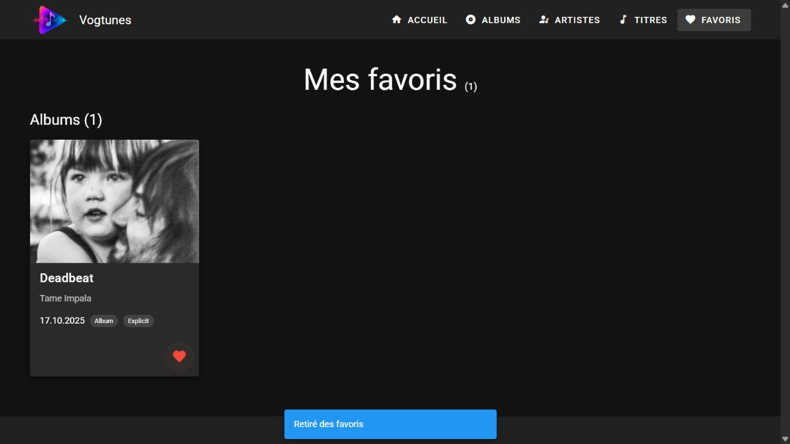

# Revue du code — 5 novembre 2026

## Périmètre et méthode

Revue de Vogtunes, dépôt `294-projet-deezer-vogtcol`, limitée aux notions des séquences 1 à 5 du tutoriel DEVJS. Les fonctionnalités déjà demandées, notamment les fiches et le menu mobile, sont conservées.

La revue couvre les composants, les pages, les stores, le routage, Axios, les utilitaires, les configurations Vite/Vuetify/Git, les dépendances déclarées et la documentation. Elle combine lecture de code, ESLint, compilation, tests isolés des stores et vérifications dans le navigateur. Ce n’est pas une garantie d’absence de tout bug, un audit de sécurité des dépendances ou un audit complet d’accessibilité.

Références : [étape 16](https://devjs.ch/exercices/pokedex-vuetify/e16.html), [récapitulatif de la séquence 5](https://devjs.ch/exercices/pokedex-vuetify/e17.html) et [consignes du projet](https://tirtho.notion.site/Projet-individuel-valuatif-Application-Vue-3-Vuetify-avec-API-268e74c07f7c80e5822adb530f7a6027).

## Problèmes corrigés

| Problème avant la revue | Conséquence | Correction et raison |
| --- | --- | --- |
| Notification située dans chaque bouton favori | Retirer une carte de `/favoris` supprimait aussi son message | Une notification commune dans `App.vue`, pilotée par le store `app`, reste montée |
| Échec de `localStorage.setItem` seulement écrit en console | L’utilisateur voyait une confirmation de succès malgré une sauvegarde perdue | Avertissement visible ; l’interaction reste possible pendant la session |
| Favori introuvable masqué par les getters | Le compteur pouvait rester supérieur au nombre de cartes, sans possibilité de retrait | Affichage des références indisponibles avec nouvelle tentative et retrait explicite |
| Identifiants sauvegardés non validés | Des doublons comme `1` et `"1"` gonflaient le compteur ; des valeurs invalides provoquaient des requêtes inutiles | Normalisation en entiers positifs sûrs et déduplication au chargement |
| Cœurs composés uniquement d’une icône | Action et état non explicités pour les lecteurs d’écran | Libellé avec le nom de l’élément et attribut `aria-pressed` |
| Classe `favorite-active` sans définition CSS | Le battement prévu à l’étape 16 ne se produisait pas | Animation CSS courte, désactivée si l’utilisateur préfère réduire les animations |
| Filtre limité à une liste fermée de valeurs déjà chargées | Impossible de choisir immédiatement un artiste absent des premières pages | `v-combobox` conserve les suggestions et permet une valeur saisie validée avec Entrée |
| Tri présenté sans préciser sa portée | Possibilité de croire que toutes les pages du catalogue sont triées | Libellé « Tri … (affichés) » et explication dans le README |
| Effacement de recherche pouvant produire `null` | État du champ moins cohérent avec sa prop texte | Normalisation en chaîne vide ; espaces inutiles retirés du filtre envoyé |
| Logo cliquable uniquement par `@click` sur un avatar | Pas de vrai lien accessible au clavier | `router-link` nommé, avec indication visuelle du focus |
| Document HTML déclaré en anglais | Prononciation incorrecte possible du contenu français | `lang="fr"` et titre de page cohérent avec Vogtunes |
| Dix erreurs ESLint | Vérification globale en échec | Correction de l’ordre des imports et du code du bouton concerné |
| README resté au stade de modèle | Installation, API, architecture, limites et aide IA non documentées | README rédigé à partir du projet réel et du bilan donné par Colin |
| `.env.example` absent | Installation depuis GitHub incomplète | Ajout d’un modèle avec l’URL publique de l’API |
| Instructions Copilot héritées du Pokédex | Références à des stores, données et fonctionnalités inexistants | Instructions courtes adaptées à Vogtunes et au périmètre de la séquence 5 |

## Détail des fichiers modifiés

### Favoris — commit `005ebcd`

- `src/stores/app.js` : le store vide du modèle sert maintenant à conserver le message, sa couleur, sa visibilité et un identifiant de notification. L’identifiant permet de relancer le délai si plusieurs actions se suivent rapidement.
- `src/App.vue` : affiche le snackbar une seule fois dans la partie commune de l’application. Le retrait d’une carte ne le détruit plus.
- `src/stores/deezerStore.js` : ajoute la validation des identifiants, le getter `unavailableFavorites`, l’action `removeFavorite`, les messages de lecture/sauvegarde et la confirmation de chaque modification. Une panne réseau ne supprime pas automatiquement un favori.
- `src/components/FavoriteButton.vue` : calcule une seule fois l’état favori avec `computed`, fournit un nom accessible et un état appuyé, appelle le store et contient l’animation du cœur. La notification locale devenue inutile est retirée.
- `src/pages/favoris.vue` : annonce le changement du compteur et permet de retirer un identifiant indisponible. Les cartes existantes restent réutilisées.

### Catalogue et accessibilité — commit `73c9227`

- `src/components/BarreRecherche.vue` : remplace le filtre fermé par un champ avec suggestions et saisie libre. Une aide explique la validation avec Entrée. Le bouton de tri précise qu’il concerne les résultats affichés.
- `src/components/CatalogueListe.vue` : normalise la recherche effacée et nettoie les espaces du filtre transmis à l’API. La pagination de 24 éléments, l’annulation et le tri restent en place.
- `src/pages/album.vue` : le libellé précise que la recherche accepte également un artiste.
- `src/components/AppHeader.vue` : rend le logo accessible comme lien sans changer les dimensions du menu ni les icônes mobiles.
- `index.html` : déclare la langue française et utilise le titre « Vogtunes – Catalogue musical ».
- `src/plugins/index.js`, `src/plugins/vuetify.js`, `src/router/index.js`, `vite.config.mjs` : ordre des imports corrigé pour respecter ESLint. Pas de modification du fonctionnement du routeur ou de l’hébergement.

### Documentation

- `README.md` : présentation, progression jusqu’à la séquence 5, installation, commandes, API, architecture, parcours de données, tests, limites, usage de l’IA, bilan personnel et sources.
- `.env.example` : configuration publique de référence.
- `.github/copilot-instructions.md` : contexte réel du projet pour les prochaines interventions.
- `docs/images/accueil.jpg` et `docs/images/favoris.jpg` : captures réelles de la copie locale corrigée.
- `docs/revue-code.md` : ce compte rendu, avec les raisons des changements et les limites conservées.

## Validation effectuée

### Code et compilation

ESLint a d’abord détecté dix erreurs dans le projet. Après correction, `npm run lint` s’est terminé avec succès. `npm run build` a produit la version de production avec succès. Le message concernant l’ancienneté de `baseline-browser-mapping` est un avertissement de l’outil ; aucune mise à jour de dépendance n’a été réalisée pour le faire disparaître.

Douze tests isolés ont réussi avec les vrais stores Pinia et des doublures API/localStorage en mémoire :

1. Identifiants normalisés et dédupliqués.
2. Ajout, sauvegarde et lecture depuis un nouveau store.
3. Indépendance des albums, artistes et titres.
4. Favori absent de l’API conservé, puis retirable explicitement.
5. Échec partiel de l’API et réussite après nouvelle tentative.
6. Refus d’écriture signalé sans perdre l’état en mémoire.
7. JSON corrompu et format global de sauvegarde invalide traités sans faire planter le store.
8. Refus de lecture du stockage signalé.
9. Paramètres de pagination et signal d’annulation transmis, objets mis en cache.
10. Réponse de catalogue mal formée rejetée.
11. Identifiants et réponse d’une fiche contrôlés.
12. Notifications successives renouvelées.

Le script utilisé pour cette revue est temporaire, extérieur au dépôt. Aucune dépendance ni infrastructure de test supplémentaire n’a été ajoutée au projet.

### Navigateur

Les contrôles suivants ont été effectués sur la copie locale préparée, puis les fichiers correspondants ont été appliqués au dépôt réel :

- Accueil et neuf cartes de la sélection.
- Trois catalogues ; pagination albums de 24 à 48 résultats.
- Filtre saisi « Tame Impala », filtre de genre « Rock », recherche « Dark Red », tri inversé et recherche sans résultat.
- Fiches titre, artiste et album ; navigation entre éléments associés et rechargement direct.
- Paramètre invalide et page 404.
- Ajout au clavier, ajout/retrait à la souris et absence de navigation lors du clic sur le cœur.
- Favoris conservés après rechargement ; retrait de la dernière carte et confirmation encore visible.
- Menu à 320 pixels : cinq liens accessibles, aucune sortie horizontale constatée sur les pages vérifiées.
- API rendue volontairement inaccessible dans un second serveur de test : catalogue et fiche montrent une alerte, avec possibilité de réessayer.
- Aucun avertissement ou erreur dans les journaux du navigateur pendant les parcours normaux contrôlés. Les erreurs réseau provoquées volontairement sont attendues dans la simulation de panne.

L’accueil du site Vercel existant et le rechargement de la fiche Deadbeat ont aussi été vérifiés. Aucun envoi GitHub ni déploiement n’a été effectué pendant cette revue.

## Choix conservés et points restant à connaître

### Adaptation du tutoriel

Le tutoriel sert de base aux notions ; l’API musicale impose une adaptation. La recherche et les filtres s’exécutent sur le serveur pour couvrir les données au-delà de la page courante. Le tri reste un `computed` local. Revenir à un filtrage limité aux premières cartes ferait perdre la recherche dans le reste du catalogue.

### Données et expérience utilisateur

- Le tri global de toutes les pages n’est pas implémenté. Sa portée est maintenant indiquée.
- Les associations restent un aperçu de 12 résultats et dépendent de noms textuels de l’API. Certains albums ou titres associés peuvent être absents du catalogue pédagogique.
- Le cache est valable pour la session ; pas d’actualisation périodique.
- Les favoris ne sont pas synchronisés entre navigateurs.
- Le mode hors ligne est absent conformément à l’exemption des consignes 2026–2027.
- Le contrôle du défilement à l’ouverture d’une fiche n’a pas reproduit de problème ; aucun changement de `scrollBehavior` n’a été ajouté.
- L’accessibilité a été améliorée sur les points identifiés, mais n’a pas été certifiée par un audit complet.

### Configuration GitHub Pages héritée

Le site utilisé est Vercel, dont la réécriture des routes fonctionne. Le fichier `.github/workflows/deploy.yml` constitue une configuration distincte héritée du modèle :

- il utilise Node.js 18, incompatible avec plusieurs dépendances actuelles ;
- il fournit `VITE_BASE_URL`, que la configuration Vite ne lit pas ;
- il ne définit pas `VITE_API_URL` ;
- les accès directs avec l’historique navigateur nécessiteraient une configuration adaptée à GitHub Pages.

Ce workflow n’a pas été corrigé ni déclenché : la revue ne change pas la plateforme Vercel déjà choisie. Il ne faut donc pas le considérer comme une seconde publication fonctionnelle. Son déclenchement sur `push` vers `main` reste présent dans le fichier hérité.

### Modifications personnelles préexistantes

Le dépôt contenait déjà un `.env` préparé pour commit, des déclarations générées et une modification de `src/assets/logo.svg`. Ces éléments ont été préservés et exclus des commits de cette revue. En particulier, `.gitignore` n’annule pas une préparation de `.env` déjà faite dans Git : ce fichier local ne doit pas être inclus dans un futur commit de livraison.

Les nouvelles corrections sont enregistrées localement. La version publique ne les recevra qu’après une publication séparée.
